# Git & GitHub — Travaux Pratiques

## Présentation du module

Ce dépôt regroupe les travaux pratiques réalisés dans le cadre du module **Git et GitHub**.

L'objectif est de découvrir et de maîtriser les outils de gestion de versions, le travail avec les branches, la collaboration et la gestion des projets avec Git et GitHub.

## Objectifs pédagogiques

- Comprendre le fonctionnement de Git et de GitHub.
- Maîtriser les commandes essentielles de Git.
- Gérer les modifications et l'historique d'un projet.
- Créer et gérer des branches.
- Comprendre les différentes méthodes de fusion.
- Configurer une connexion SSH avec GitHub.
- Utiliser les Pull Requests.
- Appliquer des règles de protection des branches.

## Environnement de travail

| Outil | Utilisation |
|---|---|
| Git | Gestion de versions |
| GitHub | Hébergement et collaboration |
| PowerShell | Exécution des commandes Git |
| SSH | Authentification sécurisée |
| Visual Studio Code | Édition des fichiers |

---

# TP1 — Les bases de Git

## Objectif

Découvrir les fonctionnalités fondamentales de Git et apprendre à gérer les modifications d'un projet.

## Travail réalisé

- Initialisation d'un dépôt Git.
- Ajout et suivi des fichiers.
- Création des premiers commits.
- Comparaison des modifications avec `git diff`.
- Consultation de l'historique avec `git log`.
- Utilisation du fichier `.gitignore`.
- Restauration des fichiers avec `git restore`.
- Modification du dernier commit avec `git commit --amend`.
- Annulation d'un commit avec `git revert`.

## Captures d'écran

### 1. Initialisation du dépôt
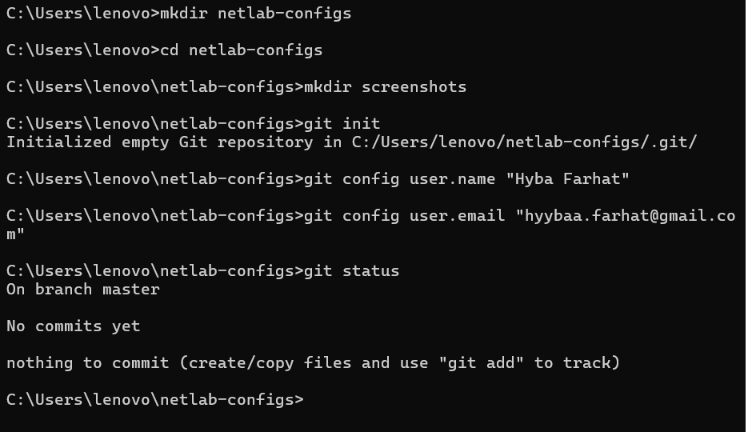

### 2. Ajout et vérification du statut
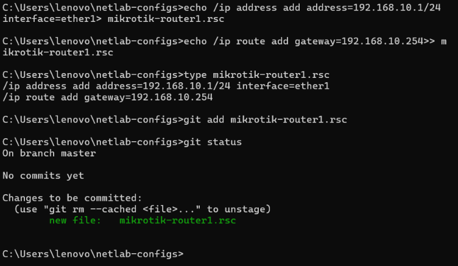

### 3. Premier commit
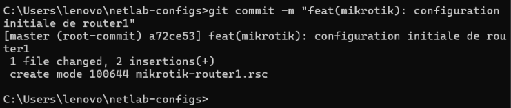

### 4. Comparaison des modifications
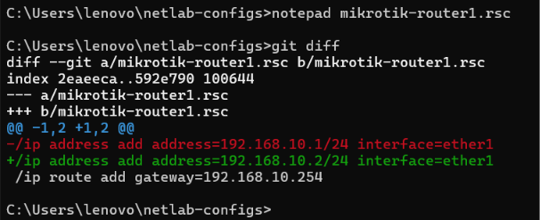

### 5. Consultation de l'historique
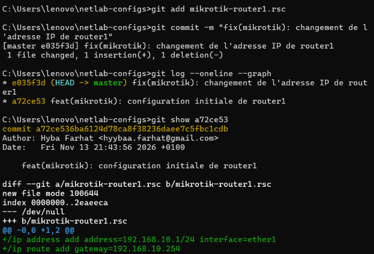

### 6. Avant la configuration de Gitignore
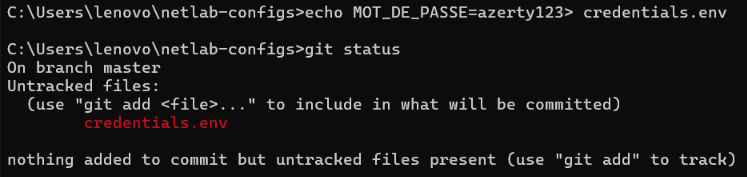

### 7. Après la configuration de Gitignore
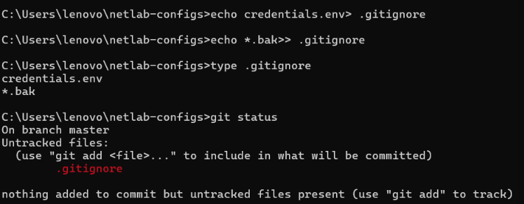

### 8. Restauration des modifications
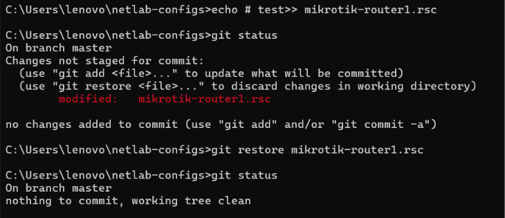

### 9. Restauration des fichiers indexés
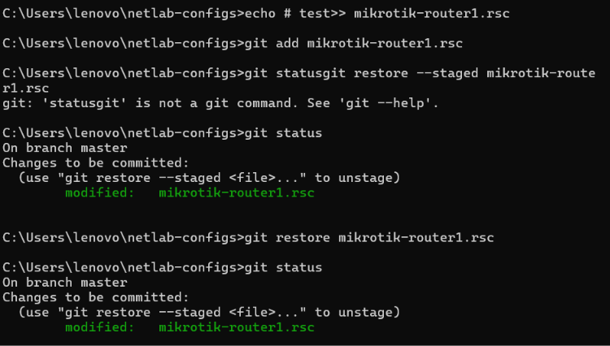

### 10. Modification du dernier commit
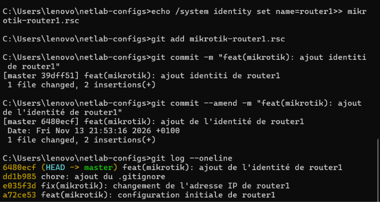

### 11. Annulation d'un commit
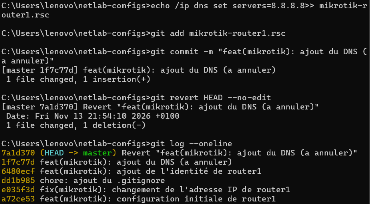

### 12. Historique final
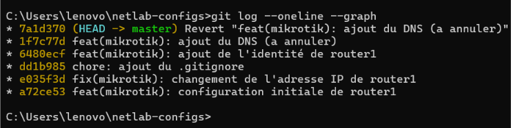

---

# TP2 — Gestion des branches et fusion

## Objectif

Apprendre à travailler avec plusieurs branches et découvrir les différentes méthodes d'intégration des modifications.

## Travail réalisé

- Création et gestion des branches.
- Réalisation d'une fusion Fast-Forward.
- Réalisation d'une fusion Three-Way Merge.
- Gestion des conflits de fusion.
- Utilisation de Git Rebase.
- Mise en attente des modifications avec Git Stash.
- Création et gestion des Tags.
- Vérification de l'historique final.

## Captures d'écran

### 1. Fast-Forward Merge
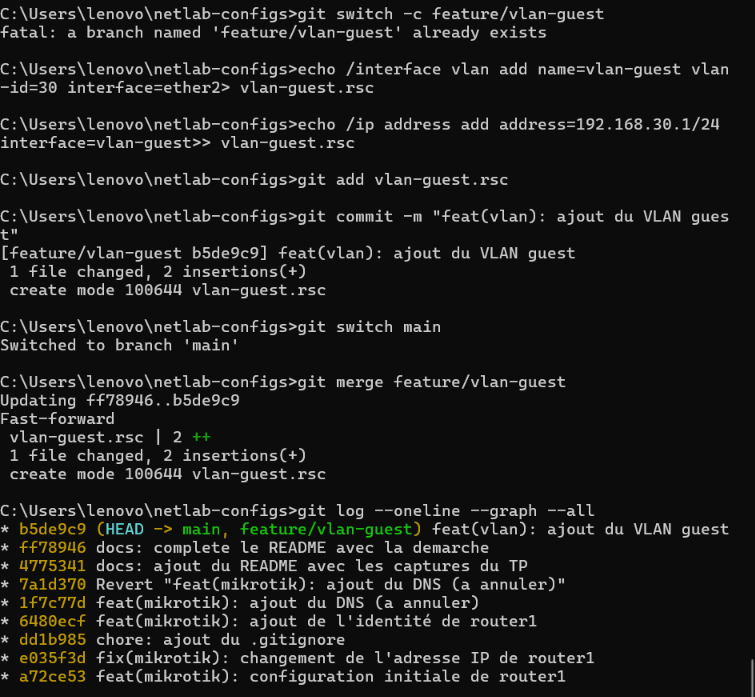

### 2. Three-Way Merge
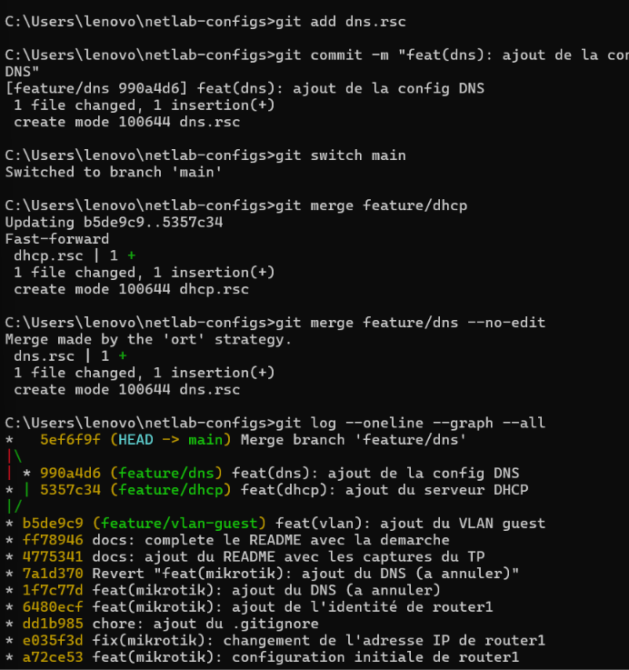

### 3. Gestion des conflits
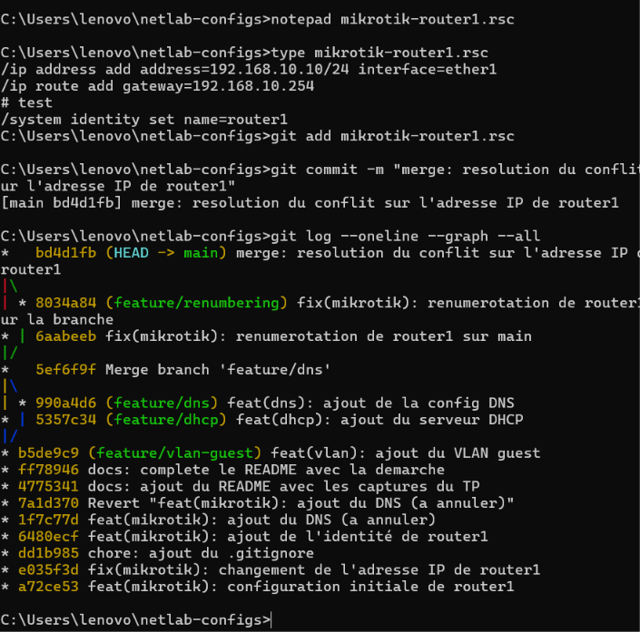

### 4. Rebase
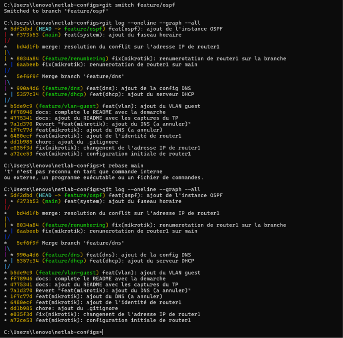

### 5. Stash et Tags
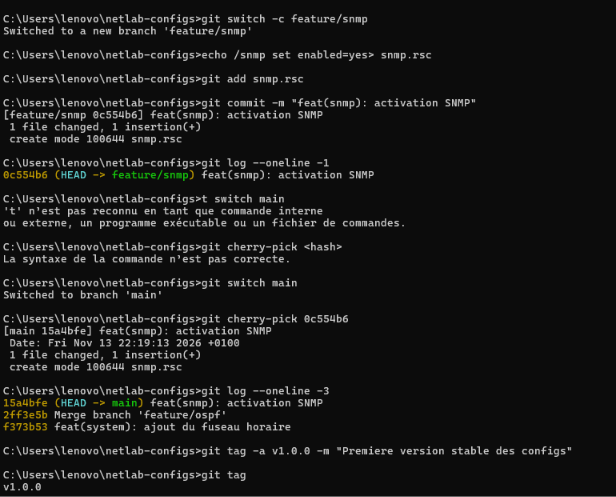

### 6. Historique final
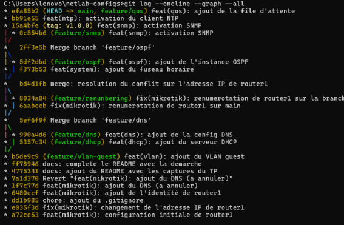

---

# TP3 — Configuration de SSH avec GitHub

## Objectif

Configurer une connexion SSH afin de communiquer avec GitHub de manière sécurisée.

## Travail réalisé

- Découverte de l'authentification SSH.
- Configuration d'une clé SSH.
- Association de la clé publique au compte GitHub.
- Vérification de la connexion SSH.

## Capture d'écran

---

# TP4 — Pull Requests et protection des branches

## Objectif

Découvrir les fonctionnalités de collaboration de GitHub et apprendre à protéger les branches importantes d'un dépôt.

## Travail réalisé

- Création d'une branche dédiée à la documentation.
- Modification du fichier README.md.
- Création et publication d'une branche distante.
- Utilisation des Pull Requests.
- Configuration du fichier CODEOWNERS.
- Mise en place des règles de protection de la branche `main`.
- Vérification du refus des Push directs sur `main`.
- Fusion d'une Pull Request avec la méthode Squash and Merge.

## Captures d'écran

### 1. Vérification du refus du Push direct
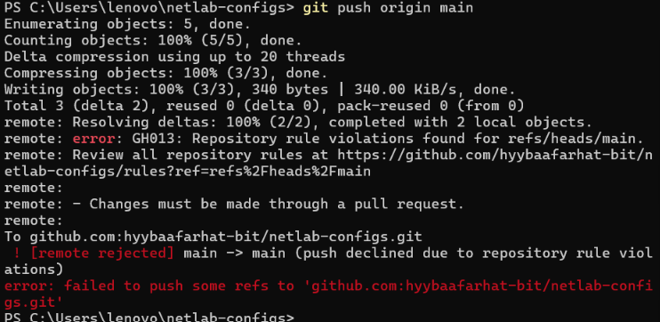

### 2. Fusion Squash and Merge
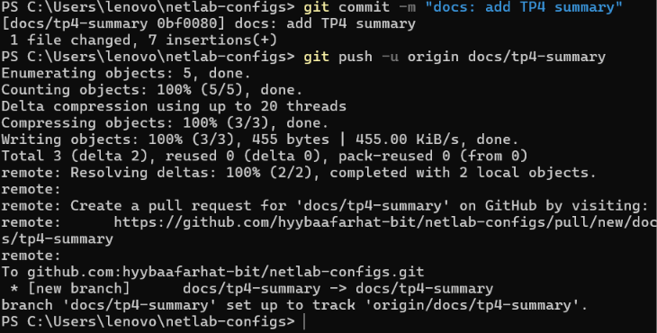

---

# Conclusion générale

À travers ces travaux pratiques, nous avons appris à utiliser Git et GitHub pour gérer les versions d'un projet, organiser le travail avec les branches, fusionner les modifications et collaborer à travers les Pull Requests.

Ces exercices nous ont permis de développer des compétences pratiques en gestion de versions et en collaboration sur des projets informatiques.

---

**Module : Git & GitHub**

**Repository :** `netlab-configs`

**Auteur :** Hiba Farhat

